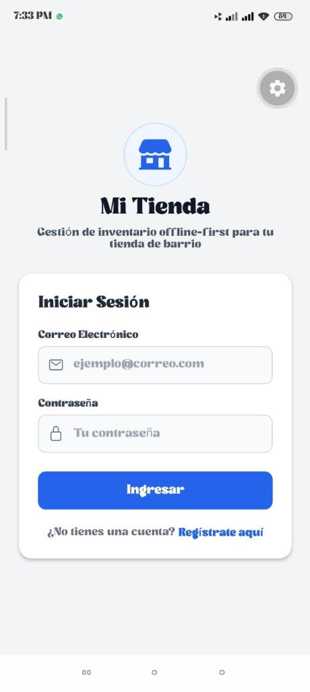
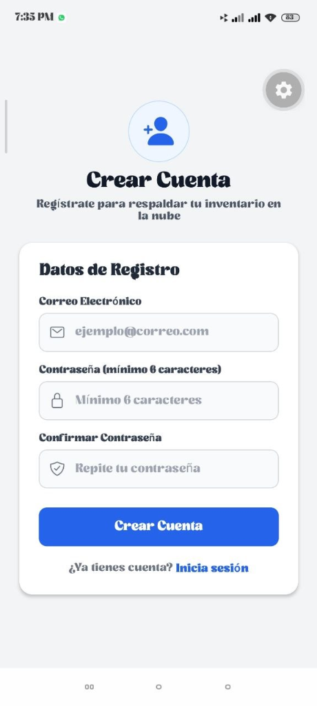
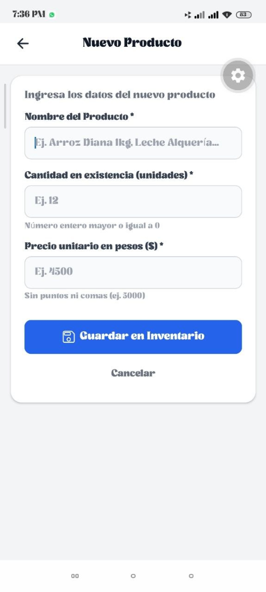
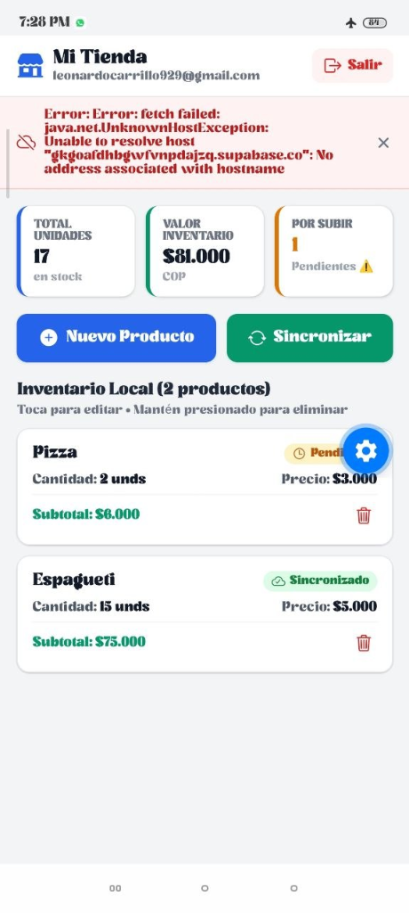
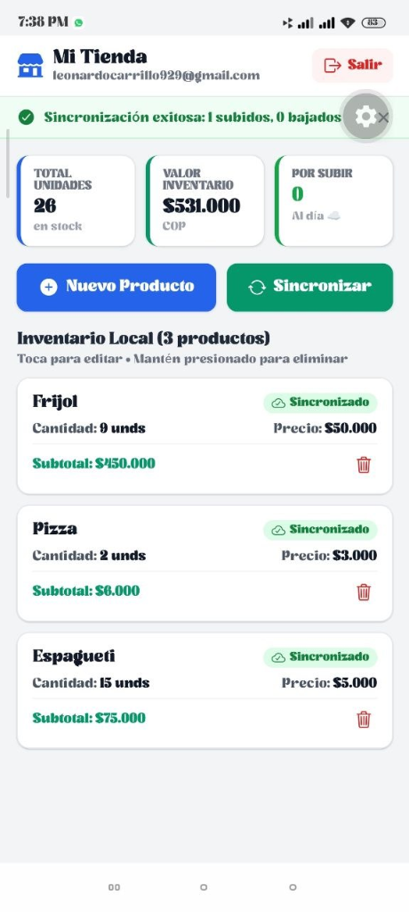

# 🏪 Mi Tienda - Gestión de Inventario Offline-First (Parcial 2)

Aplicación móvil desarrollada con **React Native**, **Expo SDK 58**, **SQLite con Drizzle ORM** (fuente de verdad local) y **Supabase** (Auth y respaldo en la nube).

---

## 👨‍🎓 Información del Estudiante

- **Nombre:** Leonardo Carrillo Caballero
- **Código:** *(Ingresa tu código estudiantil aquí)*
- **Asignatura:** Desarrollo Móvil - Parcial 2
- **Semestre:** 2026-2

---

## 🏗️ 1. Arquitectura y Stack Tecnológico

1. **Base de Datos Local (Offline-First):** SQLite síncrono mediante `expo-sqlite` y modelado tipado con `drizzle-orm`. Toda lectura y escritura en la app se realiza exclusivamente en local.
2. **Nube (BaaS & Auth):** `Supabase` para registro, inicio de sesión y respaldo en la nube de la tabla `products`.
3. **Persistencia de Sesión Segura:** `expo-secure-store` con fragmentación en chunks de 1000 bytes (anti-overflow) y auto-refresh token. Prohibido AsyncStorage.
4. **Protección Declarativa de Rutas:** `<Stack.Protected guard={...}>` en `_layout.tsx` para aislar estrictamente las rutas públicas (Login y Registro) de las privadas (Principal y Formulario).
5. **Reactividad Local:** `useLiveQuery` de Drizzle para refrescar en tiempo real los totales y la lista del inventario.
6. **Sincronización Bidireccional en 2 Pasos:** `syncProducts(userId)` descarga primero los registros remotos inexistentes y luego hace upsert de los productos modificados localmente (`syncedAt < updatedAt`).

---

## 🚀 2. Instrucciones Paso a Paso para Ejecutar el Proyecto

### Paso 1: Configurar Variables de Entorno (`.env`)
Copia el archivo `.env.example` a `.env` en la raíz del proyecto `parcial`:
```bash
cp .env.example .env
```
Asegúrate de que contenga tus credenciales de Supabase:
```env
EXPO_PUBLIC_SUPABASE_URL=https://gkgoafdhbgwfvnpdajzq.supabase.co
EXPO_PUBLIC_SUPABASE_PUBLISHABLE_KEY=eyJhbGciOiJIUzI1NiIsInR5cCI6IkpXVCJ9...
```

### Paso 2: Crear la Tabla y RLS en Supabase
Ingresa a tu consola de [Supabase](https://supabase.com/dashboard) en tu proyecto, dirígete a **SQL Editor** y ejecuta el siguiente script:

```sql
-- 1. Crear tabla de productos para Mi Tienda
create table if not exists public.products (
  id bigint generated always as identity primary key,
  user_id uuid not null default auth.uid() references auth.users (id) on delete cascade,
  client_id uuid not null unique,
  name text not null,
  quantity integer not null check (quantity >= 0),
  price integer not null check (price >= 0),
  updated_at timestamptz not null,
  created_at timestamptz not null default now()
);

-- 2. Activar Row Level Security (RLS)
alter table public.products enable row level security;

-- 3. Políticas de seguridad por usuario
create policy "Users can view their own products"
  on public.products for select
  using (auth.uid() = user_id);

create policy "Users can insert their own products"
  on public.products for insert
  with check (auth.uid() = user_id);

create policy "Users can update their own products"
  on public.products for update
  using (auth.uid() = user_id);

create policy "Users can delete their own products"
  on public.products for delete
  using (auth.uid() = user_id);
```

### Paso 3: Instalar Dependencias
```bash
npm install
```

### Paso 4: Generar Migraciones de SQLite con Drizzle
```bash
npx drizzle-kit generate
```

### Paso 5: Iniciar la Aplicación en Expo
```bash
npx expo start -c
```
- Presiona `a` para abrir en emulador de Android o escanea el QR con Expo Go en tu dispositivo físico.
- Presiona `w` para probar en navegador web.

---

## 📱 3. Evidencias de Funcionamiento (Capturas Requeridas)

A continuación se presentan las capturas organizadas con su respectiva descripción de funcionamiento:

### 🔹 Grupo 1: Flujo de Autenticación y Formulario
<table>
  <tr>
    <td align="center" width="33%">
      <br/>
      <b>01. Inicio de Sesión</b><br/>
      <sub>Pantalla <code>app/login.tsx</code> con formulario para correo y contraseña, branding de "Mi Tienda" y enlace directo a registro.</sub>
    </td>
    <td align="center" width="33%">
      <br/>
      <b>02. Registro de Usuario</b><br/>
      <sub>Pantalla <code>app/registro.tsx</code> con campos para correo, contraseña y confirmación (validación >= 6 caracteres).</sub>
    </td>
    <td align="center" width="33%">
      <br/>
      <b>04. Formulario de Producto</b><br/>
      <sub>Pantalla <code>app/producto.tsx</code> para crear o editar productos con validaciones de nombre obligatorio, unidades y precio.</sub>
    </td>
  </tr>
</table>

### 🔹 Grupo 2: Modo Offline y Sincronización con la Nube
<table>
  <tr>
    <td align="center" width="50%">
      <br/>
      <b>05. Operación en Modo Avión (Offline-First)</b><br/>
      <sub>La app sigue operando 100% sobre SQLite local con el celular en modo avión. Se evidencia producto con badge <code>Pendiente</code> y captura elegante de error de red.</sub>
    </td>
    <td align="center" width="50%">
      <br/>
      <b>06. Sincronización Exitosa</b><br/>
      <sub>Banner verde con resultado ("1 subidos, 0 bajados"), 26 unidades totales, $531.000 COP en inventario y productos con badge <code>Sincronizado</code>.</sub>
    </td>
  </tr>
</table>

| Captura | Vista / Estado | Estado en Repositorio |
| :---: | :--- | :---: |
| **01** | Inicio de sesión (`app/login.tsx`) | ✅ Agregada |
| **02** | Registro de usuario con validación (`app/registro.tsx`) | ✅ Agregada |
| **03** | Pantalla Principal - Inventario (`app/index.tsx`) | ⏳ Pendiente |
| **04** | Formulario Crear / Editar Producto (`app/producto.tsx`) | ✅ Agregada |
| **05** | Operación Offline en Modo Avión | ✅ Agregada |
| **06** | Sincronización exitosa con la nube ("X subidos, Y bajados") | ✅ Agregada |
| **07** | Tabla de Supabase con los registros respaldados | ⏳ Pendiente |

---

## ✅ 4. Checklist de Funcionalidades Operativas

- [x] **Fuente de Verdad SQLite:** Toda alta, baja, modificación y listado se ejecuta en la base local `mitienda.db`.
- [x] **Autenticación Supabase:** Login, Registro con confirmación de clave (mínimo 6 caracteres) y Logout seguro.
- [x] **Sesión Persistente:** Manejada mediante `expo-secure-store` y `AuthContext` (persiste al reiniciar).
- [x] **Stack.Protected:** Navegación blindada; usuarios no autenticados solo ven Login/Registro; autenticados acceden a Inventario y Formulario.
- [x] **Esquema Drizzle sin módulos Expo:** `src/db/schema.ts` es 100% compatible con `drizzle-kit generate`.
- [x] **Patrón Repositorio y Custom Hook:** `productRepository` aísla las consultas directas; `useProducts` provee reactividad con `useLiveQuery`.
- [x] **Métricas de Inventario:** Cálculo automático de unidades totales, valor total en pesos y conteo de pendientes.
- [x] **Sincronización Bajar y Subir:** Primero descarga registros faltantes y luego realiza upsert de registros pendientes por `client_id`.
- [x] **Tolerancia a Fallos:** Manejo elegante de desconexión / modo avión sin bloquear la experiencia de usuario.
